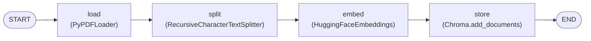

# PDF Vectorisation Pipeline

A production-ready PDF vectorisation and similarity retrieval service built with **LangChain**, **LangGraph**, **ChromaDB**, and **FastAPI**.

## Live Deployment
https://rohith-nestack-submission.onrender.com

## Quick Start

### 1. Environment Setup
```bash
# Clone the repository and navigate into it
cd project_ai

# Create and activate virtual environment
python -m venv .venv
# On Windows:
.\.venv\Scripts\activate
# On Linux/macOS:
source .venv/bin/activate

# Install dependencies
pip install -r requirements.txt

# Configure environment variables
cp .env.example .env
```

### 2. Ingest PDF Documents
Ingest the PDF document into the persistent Chroma vector store:
```bash
python ingest.py --file data/sample.pdf
```
Options available:
- `--chunk-size` (default: `1000`)
- `--chunk-overlap` (default: `150`)
- `--persist-dir` (default: `./vectorstore`)
- `--collection-name` (default: `pdf_documents`)
- `--model-name` (default: `sentence-transformers/all-MiniLM-L6-v2`)

### 3. Run the Retrieval Service
```bash
uvicorn app:app --host 0.0.0.0 --port 8000 --reload
```
Interactive Swagger API documentation is available at [http://localhost:8000/docs](http://localhost:8000/docs).

### 4. Run Tests & Generate `results.json`
```bash
python generate_results.py
```
This executes API input validation tests (empty query, whitespace query, out-of-range `top_k`) and runs sample queries against the vector store, writing the outputs to `results.json`.

---

## Component Choices & Architectural Justification

As required by the assessment specification, here is the rationale for selecting each LangChain component:

### 1. Document Loader: `PyPDFLoader`
- **Page-Level Metadata Preservation**: `PyPDFLoader` automatically captures physical page numbers in document metadata (`metadata['page']`). This is essential for fulfilling the retrieval API requirement to return 1-indexed `page_number` with every retrieved chunk.
- **Reliability & Lightweight Footprint**: Pure-Python implementation with zero system-level C dependencies (unlike `UnstructuredPDFLoader` which requires `poppler` and `tesseract`, or `PDFMinerLoader` which has higher parsing overhead).
- **Idempotent Extraction**: Deterministic text parsing guarantees consistent chunking across repeated ingestion runs.

### 2. Text Splitter: `RecursiveCharacterTextSplitter`
- **Context-Aware Semantic Splitting**: Splits hierarchically on `["\n\n", "\n", " ", ""]`. It prioritizes keeping paragraphs, question-and-answer pairs, and code blocks intact before falling back to sentence or character-level boundaries.
- **Justification for `chunk_size = 1000`**:
  - The assessment document contains technical Q&A with conceptual explanations and code examples.
  - 1000 characters corresponds to approximately 180–220 words (~200–250 tokens), which is the optimal semantic size to capture an entire question and its complete answer without premature truncation.
- **Justification for `chunk_overlap = 150`**:
  - A 150-character (~25–35 words) sliding window ensures that semantic context spanning paragraph boundaries is never lost.
  - Queries matching terms located near chunk edges retain sufficient surrounding context in adjacent chunks.

### 3. Embedding Model: `sentence-transformers/all-MiniLM-L6-v2`
- **Dense Semantic Retrieval**: Produces 384-dimensional dense vectors fine-tuned on over 1 billion sentence pairs for semantic similarity and clustering.
- **Zero API Dependency & Cost**: Fully self-hosted and offline; requires no external API keys (unlike OpenAI or Cohere) and eliminates rate limits, network latency, and billing constraints.
- **Resource & Latency Optimization**: Extremely fast CPU inference (~15 ms per chunk) and compact memory footprint (~80MB model size), enabling deployment on constrained environments (such as Render free-tier 512MB RAM).

### 4. Vector Store: `ChromaDB` (via `langchain-chroma`)
- **Native Embedded Persistence**: Chroma persists directly to disk (`./vectorstore`) using embedded SQLite and HNSW indexing, eliminating the need to run an external database daemon (like PgVector or Milvus).
- **LangChain Integration**: Built-in native support for `similarity_search_with_score()`, returning calibrated similarity distance metrics.
- **Deterministic Upserts**: Enables deterministic chunk IDs (`{filename}_p{page}_c{index}`), guaranteeing idempotent ingestion without duplicate vectors if `ingest.py` is executed repeatedly.

## Architecture

```text
PDF
 ↓
PyPDFLoader
 ↓
RecursiveCharacterTextSplitter
 ↓
HuggingFaceEmbeddings
 ↓
Chroma
 ↓
FastAPI /query
 ↓
similarity_search_with_score()
```

## LangGraph Ingestion Pipeline

The ingestion pipeline is implemented as a **LangGraph** sequential workflow (`ingest.py`).

### Graph Structure & Node List
Printed node execution order:
```text
START -> load -> split -> embed -> store -> END
```

### Visual Workflow Diagram


- **`load`**: Loads the PDF page-by-page and extracts raw page metadata.
- **`split`**: Splits pages into 1000-char chunks with 150-char overlap and normalizes 1-indexed `page_number`.
- **`embed`**: Initializes `sentence-transformers/all-MiniLM-L6-v2` with CPU optimization and vector normalization.
- **`store`**: Generates deterministic chunk IDs and persists vectors and metadata into the local Chroma directory.

### Pipeline Details

1. **Ingestion Pipeline (`ingest.py`)**:
   - Structured as an idempotent **LangGraph** sequential workflow:
     $$\text{START} \longrightarrow \text{load} \longrightarrow \text{split} \longrightarrow \text{embed} \longrightarrow \text{store} \longrightarrow \text{END}$$
   - **Load**: Extracts text and metadata page-by-page from the source PDF via `PyPDFLoader`.
   - **Split**: Segments text using `RecursiveCharacterTextSplitter` (chunk size: 1000, overlap: 150) while tracking 1-indexed `page_number` metadata.
   - **Embed**: Generates dense embeddings locally via `HuggingFaceEmbeddings` using `sentence-transformers/all-MiniLM-L6-v2`.
   - **Store**: Indexes and persists embeddings into `Chroma` with deterministic chunk IDs for idempotent execution.

2. **Retrieval API (`app.py`)**:
   - FastAPI microservice that queries the Chroma vector store directly using `similarity_search_with_score()`.
   - **Pure Retrieval**: Strictly no LLMs, conversational wrappers, or QA chains—returns raw chunk text, original page numbers, and similarity scores.
   - Validates incoming requests (`query` non-empty, `top_k` between 1 and 20).

---

## Project Structure

```text
├── data/
│   └── sample.pdf             # Input PDF document
├── vectorstore/               # ChromaDB persistent storage directory
├── app.py                     # FastAPI retrieval server
├── ingest.py                  # LangGraph-based ingestion pipeline
├── generate_results.py        # Validation tests and results generator
├── results.json               # Real query results and benchmark output
├── requirements.txt           # Python dependencies
├── .env.example               # Example environment configuration
├── .env                       # Local environment variables
├── Dockerfile                 # Container image specification
├── docker-compose.yml         # Multi-service container orchestration
└── .dockerignore              # Files excluded from Docker context
```

---

## API Specification

### `POST /query`
Performs vector similarity search against the indexed PDF chunks.

#### Request Body
```json
{
  "query": "What is the difference between supervised and unsupervised learning?",
  "top_k": 3
}
```

#### Response Body
```json
[
  {
    "chunk_text": "REGEN AI PREP\nAI Developer Intern -- Deep Dive Q&A\nTopic 2...",
    "page_number": 5,
    "score": 0.6477
  }
]
```

### `GET /health`
Returns service health status.
```json
{
  "status": "healthy"
}
```

---

## Docker & Docker Compose

### Run API with Docker Compose
```bash
docker compose up -d
```
The API will be available at `http://localhost:8000`.

### Run Ingestion with Docker Compose
```bash
docker compose run --rm ingest
```

### Build and Run with Docker directly
```bash
docker build -t pdf-retrieval-api .
docker run -p 8000:8000 -v $(pwd)/vectorstore:/app/vectorstore pdf-retrieval-api
```
